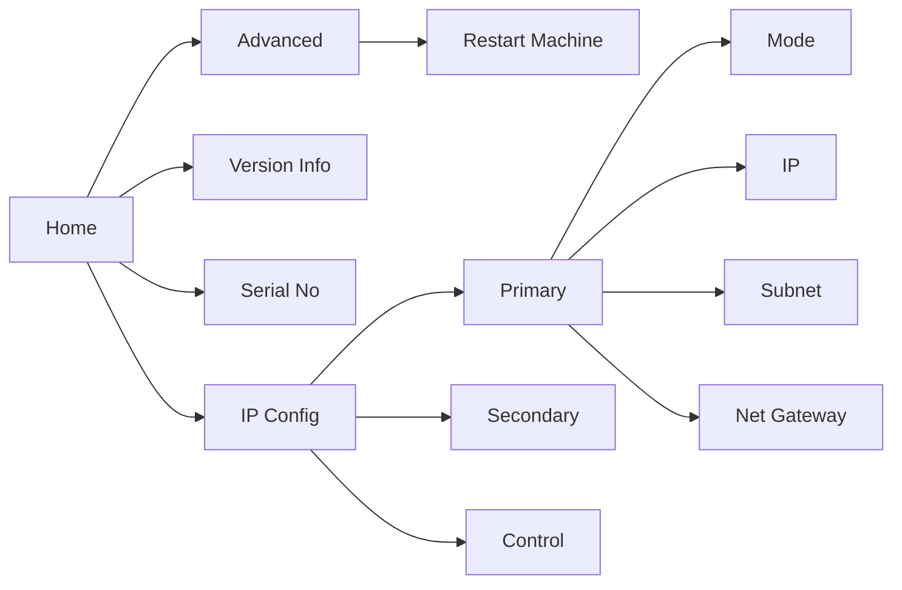

# OLED Display

The handy OLED display on the front informs you of the system status of the unit as well as letting you perform basic configuration of the device.

## Status Display

- **Cable connections**: `pri`, `sec`, `ctl` and `psu` show a tick or cross for
  the corresponding network and power connections.
- **System monitor**: a large **ok** indicates a healthy system status. a
  **warning triangle** indicates an error condition. The triangle does not
  identify a specific fault; check [System > System
  Status](../transform.client/system/system-status.md) in **transform**.client
  for more information.

:::info

A warning triangle will appear while **transform**.engine starts. Once the unit
finishes loading successfully, it will change to **ok**. If the warning
triangle remains, check the cable connections and
[System Status](../transform.client/system/system-status.md) in
**transform**.client for more information.

:::

## Menu

If you push the rotary knob on the front once, you'll enter the transform menu.
The options are:

### IP Configuration
This menu lets you configure the IP address for each network interface.

If a port is controlled by the currently selected audio transport, this is indicated in
the IP Configuration menu for that port. To regain control over the interface, change the currently selected Audio Transport in [System Status](../../transform.client/system/system-status).

**Mode:** Each interface can have its IP address configured differently:

* **Static**: Manually configured by you!
* **DHCP**: Receives an IP address from a DHCP server on your network. If no DHCP server is found, no address will be assigned.
* **Link Local**: Automatically configures IP address in the `169.254/16` subnet (or the `172.31/16`
  subnet for the Dante Secondary port).
* **Unconfigured**: When no IP address is needed.

**IP:** In **Static** addressing mode, the IP address you would like the device to use.

**Subnet Prefix:** In **Static** addressing mode, the subnet you would like the device to be on.
Common values are:
* `/24` (equivalent to a mask of `255.255.255.0`)
* `/16` (equivalent to a mask of `255.255.0.0`)
* `/8` (equivalent to a mask of `255.0.0.0`)

:::warning

When configuring IP addresses, each interface must be on a non-overlapping subnet for proper operation.
If assigning addresses via DHCP, ensure that the DHCP server(s) assign addresses in non-overlapping subnets to each interface.

:::

**Net Gateway:** In **Static** addressing mode, optionally, the IP address of a
gateway host to use to reach other subnets. This is not usually needed and can
be set to `No` (default) to communicate only on the configured subnet.

### Version Info
What version of the **transform**.core software this hardware is running.

### Serial Number
A magic code you can use to obtain drinks tokens at any Fourier Audio event. Only joking.

### Advanced
**Restart Machine**: For when you've had enough. As it suggests, when confirmed, this will restart your **transform**.engine.

We apologise if you have found an error and needed to restart; if you have the time, please send an
email to [support@fourieraudio.com](mailto:support@fourieraudio.com). We would love to avoid this
happening again!
